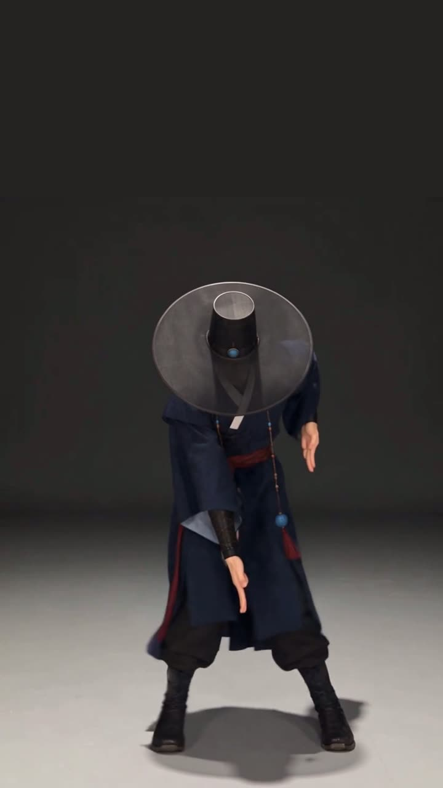

# 조선헌터스 SNS 소재 · 2026-10-27 — 도호 「BAD」 챌린지

| 파일 | 규격 | 공개 | 스포일러 |
|---|---|---|---|
| [doho_bad_dance_9x16.mp4](doho_bad_dance_9x16.mp4) | 1080×1920 · 30fps · 10.03초 · **소리 없음** · 5,244,216B | 공개 | none |

SHA256 `57f54cb87ece5e956d0e67460c4457511e6dd9b4ca156be02b9e601d8e6b6c3f`

- 주인공 도호가 에이티즈 「BAD」 챌린지 안무를 춥니다. 흑립 챙이 얼굴을 가린 채 추고, 4~5초에 고개를 깊이 숙입니다.
- **음원은 파일에 없습니다.** 올릴 때 Instagram·TikTok·YouTube 앱 안 음악에서 「BAD」(ATEEZ)를 붙이세요.
- 위쪽 480px는 배경색 빈 공간입니다. 자막·제목 자리로 쓰세요.
- 만든 법(게임 카드 #948): H1 도호 정면 원화 + 안무 튜토리얼 영상 → Higgsfield Genjutsu 동작 전이(10초) → Seedance 2.5 편집(고개 숙임) → 9:16 정리. AI 생성 영상입니다. 안무 참고 영상 원본은 이 저장소에 넣지 않았습니다.

---

**EN** — Doho, the hero of Joseon Hunters, dances the ATEEZ "BAD" challenge (vertical 9:16, 10 s, silent — add the song from the platform's in-app music). AI-generated video (Higgsfield Genjutsu motion transfer + Seedance 2.5 edit) from the approved H1 Doho art. The reference choreography video is not stored here.
